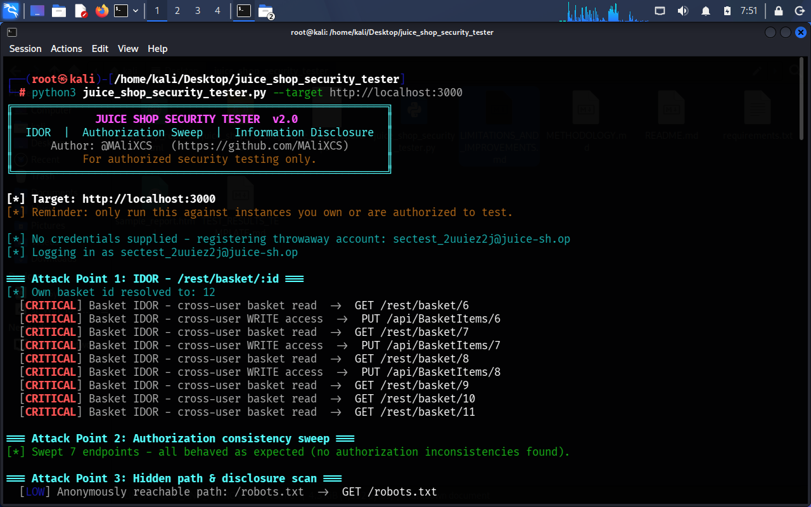
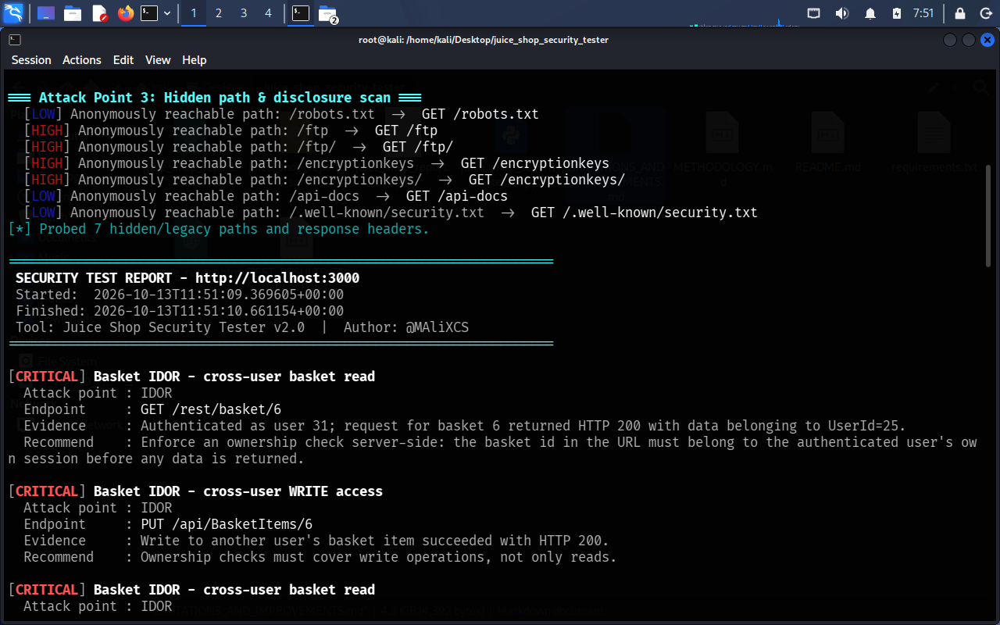
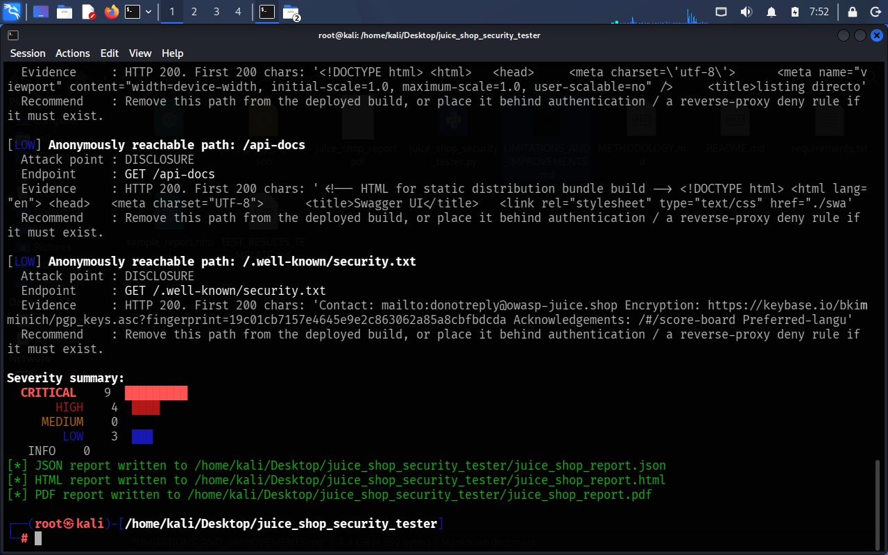
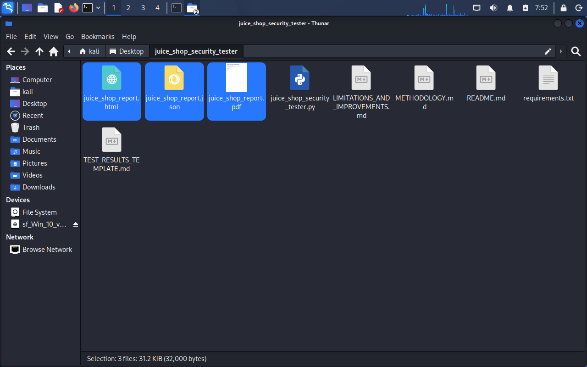

# Juice Shop Security Tester

**v1.0** — an automated security testing tool for **OWASP Juice Shop**, a
deliberately vulnerable training application. It runs three coordinated
attack-point tests through one shared engine and generates a color-coded,
severity-grouped report — in JSON, HTML, and PDF — with a clickable table
of contents.

Built during a **Cybersecurity Internship at Cronova Solutions**.

> ⚠️ **Scope:** Only run this against OWASP Juice Shop instances you own or
> are explicitly authorized to test. Do not point this at third-party
> infrastructure.

---

## Table of Contents

- [What this tool does](#what-this-tool-does)
- [How it works](#how-it-works)
- [Screenshots — a real run](#screenshots--a-real-run)
- [Requirements](#requirements)
- [Installation](#installation)
- [Quick start](#quick-start)
- [Full command reference](#full-command-reference)
- [User manual — feature by feature](#user-manual--feature-by-feature)
- [Report formats](#report-formats)
- [Project structure](#project-structure)
- [Troubleshooting](#troubleshooting)
- [Author](#author)
- [Legal / Scope](#legal--scope)
- [License](#license)

---

## What this tool does

| # | Attack point | Target | OWASP category |
|---|---|---|---|
| 1 | **IDOR** | `/rest/basket/:id` | Broken Access Control (A01) |
| 2 | **AUTH-SWEEP** | Authorization consistency across public, session-gated, and admin-gated endpoints | Broken Access Control (A01) |
| 3 | **DISCLOSURE** | Hidden/legacy paths and information-disclosure headers (`/ftp`, `/encryptionkeys`, `/robots.txt`, `X-Powered-By`, etc.) | Security Misconfiguration (A05) |

Every finding from all three attack points flows into one shared collector,
grouped by severity (`CRITICAL → HIGH → MEDIUM → LOW → INFO`), and exported
simultaneously to **JSON**, **HTML**, and **PDF** — written next to the
script itself regardless of which directory you ran it from.

## How it works

**IDOR test:** the tool logs in (or registers a throwaway account), reads
that account's own basket id from its session, then requests a window of
*neighboring* basket ids using that same, unmodified session token. A result
only becomes a finding when the server returns `HTTP 200` **and** the
returned data belongs to a *different* user id — that's the difference
between "the id doesn't exist" (not a finding) and "the server handed over
someone else's data" (a real access-control failure). It then separately
checks whether `PUT` (write) access is exposed the same way as `GET` (read)
access.

**Authorization sweep:** the tool holds a map of endpoints that are
*supposed* to be public, session-gated, or admin-only, and requests each one
under the current session — flagging any endpoint whose actual behavior
doesn't match its expected gate (e.g. an admin-only endpoint that responds
to a normal session).

**Disclosure scan:** the tool requests a curated list of legacy/forgotten
paths and inspects response headers for information that shouldn't be
reachable anonymously, grading each finding by how much it actually
discloses (directory listings and key material are `HIGH`; metadata like
`robots.txt` is `LOW`).

**Reporting:** every finding — regardless of which test produced it — is
recorded through one shared `_add_finding()` call, so severity counts, the
table of contents, and all three export formats always stay consistent with
each other.

## Screenshots — a real run

**Attack Point 1 (IDOR)** — cross-user basket read and write access
confirmed across multiple basket ids, using nothing but the test account's
own session:



**Attack Point 3 (disclosure scan)** and the first `CRITICAL` findings
appearing in the generated report body:



**Severity summary** and confirmation that all three report files were
written successfully:



**The project folder** — all three generated reports sitting next to the
script itself, as designed:



---

## Requirements

- Python 3.8+
- [`requests`](https://pypi.org/project/requests/) — **required**
- [`fpdf2`](https://pypi.org/project/fpdf2/) — **optional**, only needed for
  the PDF report. Without it, the tool still runs fine and produces JSON +
  HTML.
- A running Juice Shop instance to point it at.

## Installation

```bash
git clone https://github.com/MAliXCS/juice-shop-security-tester.git
cd juice-shop-security-tester
pip install -r requirements.txt --break-system-packages
```

> `--break-system-packages` is needed on Kali/Debian-based systems because
> the system Python is externally managed. Drop it if you're using a venv.

If you don't already have a Juice Shop instance running:

```bash
docker run --rm -p 3000:3000 bkimminich/juice-shop
```

## Quick start

```bash
python3 juice_shop_security_tester.py --target http://localhost:3000
```

This registers a throwaway test account, runs all three attack points, and
writes `juice_shop_report.json`, `juice_shop_report.html`, and
`juice_shop_report.pdf` next to the script. On launch you'll see:

```
JUICE SHOP SECURITY TESTER  v1.0
IDOR  |  Authorization Sweep  |  Information Disclosure
Author: @MAliXCS   (https://github.com/MAliXCS)
For authorized security testing only.
```

---

## Full command reference

```
python3 juice_shop_security_tester.py --target <url> [options]
```

| Flag | Required | Default | Description |
|---|---|---|---|
| `--target` | **Yes** | — | Base URL of the Juice Shop instance. A reachability check runs before anything else. |
| `--test` | No | `all` | Which attack point(s) to run: `idor`, `auth`, `disclosure`, or `all`. |
| `--username` / `--password` | No | — | Use an existing account instead of auto-registering a throwaway one. Must be given together. |
| `--output` | No | `juice_shop_report` | Base filename (no extension). A relative name still writes next to the script; an absolute path overrides that. |
| `--format` | No | `all` | `json`, `html`, `pdf`, or `all` — which report format(s) to generate. |
| `--no-color` | No | off | Disables ANSI color in terminal output. |
| `--verbose` | No | off | Prints extra `[debug]` lines — login state, resolved ids, unexpected status codes. |

See [`docs/COMMANDS.md`](docs/COMMANDS.md) for every flag with extended
examples and combinations.

---

## User manual — feature by feature

A full step-by-step manual, covering **how to use each feature and which
command triggers it**, lives in [`docs/MANUAL.md`](docs/MANUAL.md). Quick
summary:

| Feature | Command to use it | What you get |
|---|---|---|
| Run everything | `python3 juice_shop_security_tester.py --target <url>` | All 3 attack points, all 3 report formats |
| IDOR test only | `--test idor` | Just the basket IDOR sweep |
| Authorization sweep only | `--test auth` | Just the endpoint-consistency check |
| Disclosure scan only | `--test disclosure` | Just the hidden-path/header scan |
| Use a real account | `--username <email> --password <pass>` | Tests run as that account instead of a throwaway one |
| Name the report | `--output <name>` | Reports written as `<name>.json/.html/.pdf` |
| Pick report format(s) | `--format json\|html\|pdf\|all` | Only generate the format(s) you need |
| Quiet terminal output | `--no-color` | Plain text, no ANSI colors |
| Debug a stuck run | `--verbose` | Extra `[debug]` diagnostic lines |

Full walkthroughs, with what each feature actually looks like when it runs,
are in [`docs/MANUAL.md`](docs/MANUAL.md).

---

## Report formats

Every report groups findings by severity (`CRITICAL → HIGH → MEDIUM → LOW →
INFO`) and color-codes each level consistently:

| Severity | Color |
|---|---|
| CRITICAL | `#b00020` |
| HIGH | `#dc3545` |
| MEDIUM | `#e6962d` |
| LOW | `#2d7dd2` |
| INFO | `#6c757d` |

- **JSON** — the raw `TestRun` object. Good for feeding into other tooling.
- **HTML** — a dark-themed page with a severity-summary card row, a
  color-coded table of contents with jump links, and findings grouped into
  color-coded sections.
- **PDF** — same structure as the HTML report: a cover page with the
  severity summary, a clickable table of contents, and findings grouped
  under color-coded section headers that the TOC links jump to directly.

---

## Project structure

```
juice-shop-security-tester/
├── juice_shop_security_tester.py   # the tool itself (v1.0)
├── requirements.txt                 # pip dependencies (end users)
├── requirements-dev.txt             # extra dependencies for contributors
├── README.md                        # this file
├── docs/
│   ├── COMMANDS.md                  # exhaustive CLI flag reference
│   └── MANUAL.md                    # full step-by-step user manual
├── screenshots/                     # real-run screenshots used in this README
│   ├── 01-idor-attack.png
│   ├── 02-disclosure-and-findings.png
│   ├── 03-severity-summary.png
│   └── 04-generated-reports-folder.png
├── .github/
│   ├── ISSUE_TEMPLATE/
│   │   ├── bug_report.md
│   │   └── feature_request.md
│   └── PULL_REQUEST_TEMPLATE.md
├── CHANGELOG.md
├── CONTRIBUTING.md
├── CODE_OF_CONDUCT.md
├── SECURITY.md
├── LICENSE
└── .gitignore
```

## Troubleshooting

**`This tool requires the 'requests' library.`**
Run `pip install -r requirements.txt --break-system-packages`.

**`[!] PDF export requires the 'fpdf2' package.`**
PDF generation is optional. Install `fpdf2` to enable it, or just use
`--format json` / `--format html` without it.

**`[!] Target unreachable. Aborting.`**
Confirm the Juice Shop instance is actually running and reachable from where
you're running the script (check the port, firewall, and that you didn't
typo `http`/`https`).

**IDOR test says "skipped (no auth session)"**
Either account registration or login failed. Run with `--verbose` to see the
HTTP status codes involved, or supply `--username`/`--password` for an
account you know works.

**A field in the PDF looks shortened/truncated**
The PDF renderer is deliberately defensive: if one line genuinely can't be
rendered, it's shortened rather than crashing the whole report, and a
`[!] PDF: had to shorten one report line...` warning is printed when that
happens. The full, untruncated text is always still in the JSON and HTML
reports.

## Author

**Muhammad Ali Mobeen** — [@MAliXCS](https://github.com/MAliXCS)
Cybersecurity Intern, **Cronova Solutions**

## Legal / Scope

This tool is for **authorized security testing only**, against OWASP Juice
Shop instances you own or have explicit permission to test. Do not point it
at third-party infrastructure.

## License

See [`LICENSE`](LICENSE).
